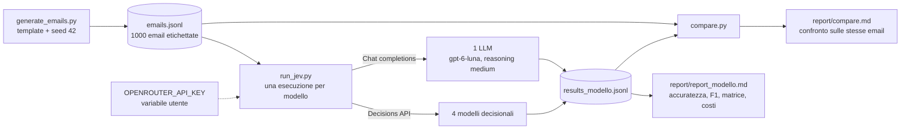
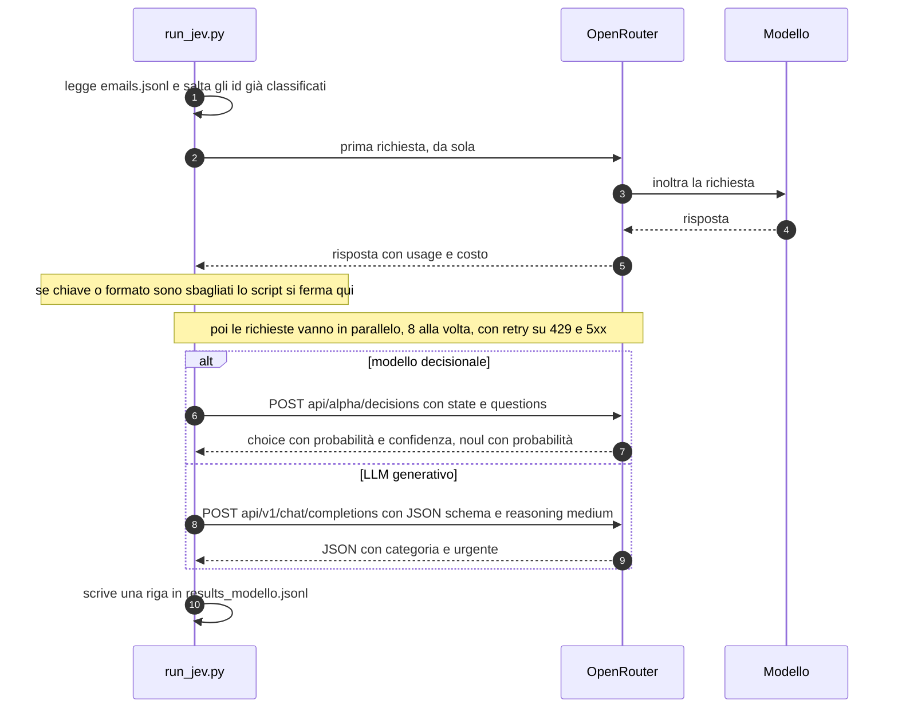
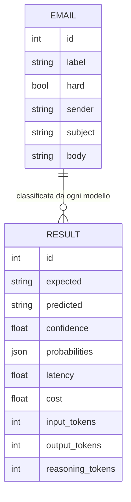

# Demo: classificare 1000 email con modelli decisionali e con un LLM

Questa demo confronta **modelli decisionali** (Jev, Microsoft Decision, Perplexity Decider, GPT-6 Luna Decisions) con **un LLM generativo** (GPT-6 Luna) su un compito concreto: assegnare ogni email a una di 8 categorie. Tutto passa da OpenRouter, con la stessa chiave API e gli stessi dati.

## 1. Cosa vogliamo mostrare

- Un modello decisionale **non genera testo**: risponde a domande tipizzate (`choice`, `noul`, `score`) e restituisce **probabilità** per ogni opzione, con una confidenza.
- Un LLM risponde con testo (qui forzato a JSON): ottiene l'etichetta, ma **nessuna probabilità**.
- Confrontiamo i due approcci su accuratezza, **calibrazione della confidenza**, latenza e costo, sulle stesse email.

## 2. Architettura in una pagina



Tre script, solo libreria standard di Python, nessuna dipendenza da installare.

| Script | Compito |
|---|---|
| `generate_emails.py` | Genera le 1000 email finte (italiano, un po' di inglese) con l'etichetta corretta. Deterministico: stesso `--seed`, stesso set. |
| `run_jev.py` | Manda ogni email a un modello via OpenRouter, salva una riga per email in `results_<modello>.jsonl` e produce `report/report_<modello>.md`. |
| `compare.py` | Mette a confronto tutti i `results_*.jsonl` sulle sole email classificate da tutti i modelli e scrive `report/compare.md`. |

## 3. Il compito: 8 categorie

| Categoria | Cos'è |
|---|---|
| `personale` | Amici e familiari, tono privato |
| `professionale` | Lavoro tra colleghi, clienti, fornitori già in relazione |
| `spam` | Posta indesiderata e truffe grossolane (lotterie, eredità, farmaci) |
| `pubblicita` | Promozioni di negozi e brand: sconti, codici, carrelli abbandonati |
| `newsletter` | Pubblicazioni periodiche a cui ci si è iscritti |
| `proposta_commerciale` | Offerte B2B serie e mirate: collaborazioni, preventivi, partnership |
| `phishing` | Furto di credenziali o denaro fingendosi banca, ente o superiore |
| `notifica_automatica` | Messaggi di sistema: ordini, ricevute, codici OTP, promemoria |

Le 1000 email (seed 42) sono così ripartite: personale 130, professionale 130, spam 120, pubblicità 120, newsletter 110, proposta commerciale 120, **phishing 150**, notifica automatica 120. Circa il **20%** sono casi **difficili** (campo `hard`), pensati per mettere in crisi i modelli:

- newsletter che contiene un codice sconto;
- spam travestito da offerta di lavoro;
- proposta commerciale che somiglia a spam;
- CEO fraud, cambio IBAN, falsa risposta con link, richiesta di gift card (phishing);
- avviso di sicurezza legittimo che sembra phishing;
- collega che scrive di una questione personale dalla mail aziendale.

## 4. I modelli a confronto

| Modello (OpenRouter) | Tipo | Endpoint | Output |
|---|---|---|---|
| `typesafe/jev-1.14` | Decisionale | Decisions API | Scelta, probabilità, confidenza |
| `microsoft/microsoft-decision-1` | Decisionale | Decisions API | Scelta, probabilità, confidenza |
| `perplexity/pplx-decider-flash-v1.2` | Decisionale | Decisions API | Scelta, probabilità, confidenza |
| `openai/gpt-6-luna-decisions` | Decisionale | Decisions API | Scelta, probabilità, confidenza |
| `openai/gpt-6-luna` | **LLM** | Chat completions | Solo etichetta (JSON a schema) |

Fuori dalla demo, per ora: **Laya**, perché gira in locale e non passa da OpenRouter. Per aggiungerlo basterà un adattatore che scriva lo stesso formato di `results_*.jsonl`.

### Come vengono interrogati



**Modelli decisionali.** Un'unica richiesta con `state` (l'email) e due domande:

```json
{
  "model": "typesafe/jev-1.14",
  "state": "Da: ...\nOggetto: ...\n\ncorpo dell'email",
  "questions": {
    "categoria": { "type": "choice", "instructions": "In quale categoria rientra questa email?",
                   "criteria": { "personale": "…", "spam": "…", "phishing": "…" } },
    "urgente":   { "type": "noul",   "instructions": "Il destinatario deve agire con urgenza?" }
  }
}
```

**LLM.** Stessi criteri, ma nel prompt di sistema; la risposta è vincolata da un JSON schema con `enum` sulle 8 categorie, `temperature 0`. Il reasoning è **medium** ed è l'unico setup usato nel confronto.
Per provare un altro livello si cambia `MODEL_DEFAULTS` in cima a `run_jev.py`, oppure si passa `--reasoning none|low|medium|high`.

**Perché le domande sono identiche.** Le categorie e le loro descrizioni sono le stesse per tutti: cambia solo il modo in cui il modello risponde, non il compito.

## 5. Cosa viene registrato per ogni email



`confidence` e `probabilities` esistono solo per i modelli decisionali. Il costo è quello restituito da OpenRouter (`usage.cost`), non una stima.

## 6. Cosa produce il confronto (`report/compare.md`)

1. **Riepilogo**: accuratezza con intervallo di confidenza al 95%, accuratezza su email facili e difficili, F1 macro, latenza mediana e p95, costo ogni 1000 email.
2. **Recall per classe**, un modello per colonna.
3. **Sicurezza sul phishing**: quanti phishing vengono scambiati per posta legittima (l'errore più grave), per spam, e quanti falsi allarmi.
4. **Affidabilità della confidenza**: che confidenza ha il modello quando ha ragione e quando sbaglia. È dove i modelli decisionali hanno qualcosa in più rispetto all'LLM: una soglia permette di mandare a revisione manuale i casi dubbi.
5. **Email controverse**: quelle su cui i modelli non concordano e quelle sbagliate da tutti, che sono probabili etichette ambigue.
6. **Classifiche**: i più veloci (latenza mediana) e i meno costosi (costo ogni 1000 email e ogni 1000 risposte corrette), con il rapporto rispetto al migliore.

## 7. Come eseguire la demo

Su questa macchina `python` non è nel PATH, quindi si usa il percorso completo.

```powershell
cd C:\temp\jev-test
$py = "C:\Users\Antonio Esposito\AppData\Local\Programs\Python\Python312\python.exe"

# 1. chiave (variabile utente, da rimuovere a fine demo)
[Environment]::SetEnvironmentVariable("OPENROUTER_API_KEY", "sk-or-...", "User")
$env:OPENROUTER_API_KEY = [Environment]::GetEnvironmentVariable("OPENROUTER_API_KEY", "User")

# 2. dati (già generati: rigenerare solo se serve un set nuovo)
& $py generate_emails.py

# 3. un modello alla volta (riprende da dove si è fermato)
& $py run_jev.py --model typesafe/jev-1.14
& $py run_jev.py --model microsoft/microsoft-decision-1
& $py run_jev.py --model perplexity/pplx-decider-flash-v1.2
& $py run_jev.py --model openai/gpt-6-luna-decisions
& $py run_jev.py --model openai/gpt-6-luna            # LLM, reasoning medium

# 4. confronto
& $py compare.py

# 5. a fine demo
[Environment]::SetEnvironmentVariable("OPENROUTER_API_KEY", $null, "User")
Remove-Item Env:OPENROUTER_API_KEY -ErrorAction SilentlyContinue
```

Per lavorare a tranche, `run_jev.py` accetta `--limit N` (quante email) e `--offset N` (da quale saltare): per esempio `--limit 100` classifica le prime 100 e `--offset 100 --limit 200` le successive 200. I risultati si accodano nello stesso file del modello. `compare.py --out report\compare_300.md` salva il confronto con un nome a scelta.

### Prima di registrare

- **Non rigenerare `emails.jsonl` dopo aver lanciato i modelli.** I risultati sono legati agli id delle email: un set diverso renderebbe i confronti privi di senso.
- La cartella è stata ripulita dopo il preflight: non ci sono risultati né report precedenti, ogni modello parte da zero. Resta solo `emails.jsonl`.
- Il preflight (20 email per modello) è servito **solo a controllare che tutto funzioni**: con 20 email la differenza tra due modelli è di una o due email, quindi non va citato come risultato.
- Tra le prime 20 email c'è un'email molto ambigua (spam con link a un documento, "Re: Re: tua richiesta") che più modelli classificano come phishing. Se capita nel video, è un buon esempio di etichetta discutibile, non solo di errore del modello.

## 8. Traccia per il video

| # | Cosa mostrare | Cosa dire |
|---|---|---|
| 1 | Il diagramma della sezione 2 | Cinque modelli, stessi dati, stessa chiave. Quattro rispondono con probabilità, uno con testo. |
| 2 | Un'email di `emails.jsonl` | Dati sintetici ma costruiti con casi difficili: promo dentro una newsletter, CEO fraud, avvisi legittimi che sembrano phishing. |
| 3 | Le 8 categorie e i criteri | Gli stessi criteri vanno a tutti i modelli: confronto equo. |
| 4 | Richiesta decisionale e richiesta LLM affiancate (sezione 4) | Il decisionale risponde a una domanda tipizzata con probabilità. L'LLM deve essere forzato a dare JSON, e non dà alcuna confidenza. |
| 5 | Lancio di `run_jev.py` con `--limit 20` | Mille email costano pochi centesimi e richiedono pochi minuti. Il costo si legge dal campo `usage.cost` di OpenRouter. |
| 6 | Un `report/report_<modello>.md` | Accuratezza, matrice di confusione, errori più sicuri di sé. |
| 7 | `report/compare.md`, sezioni 1 e 3 | Quale modello sbaglia meno e, soprattutto, quali errori: un phishing scambiato per posta legittima pesa più di una newsletter scambiata per pubblicità. |
| 8 | `report/compare.md`, sezione 4 | La confidenza dei modelli decisionali permette di mandare a revisione manuale i casi dubbi. Con l'LLM non è possibile. |
| 9 | Email controverse | Dove i modelli non concordano, spesso è l'etichetta a essere ambigua. |

## 9. Limiti da dichiarare nel video

- **Dati sintetici**: le email vengono da template, con varietà limitata. Un modello può essere bravo sui template e meno su posta reale.
- **Etichette discutibili**: alcune email sono ambigue per costruzione. Per questo il confronto ha un intervallo di confidenza e la sezione "sbagliate da tutti".
- **Un solo prompt per l'LLM**: non è stato ottimizzato. Con prompt, esempi o un altro reasoning potrebbe cambiare. Nel preflight il livello di reasoning non ha cambiato l'accuratezza su 20 email, ma ha cambiato latenza e costo.
- **Latenza**: dipende da rete, orario e carico dei provider, oltre che dal modello. Va letta come ordine di grandezza.
- **Costi**: sono quelli addebitati da OpenRouter nel momento della prova e possono cambiare. I modelli decisionali fatturano gli input e hanno output gratuito. L'LLM fa pagare anche i token di output e di reasoning.
- **Laya** non è incluso, perché gira in locale e il confronto sarebbe sbilanciato da hardware e rete.

## 10. Struttura della cartella

```text
C:\temp\jev-test
├── generate_emails.py              generatore delle email finte
├── run_jev.py                      client OpenRouter + report per modello
├── compare.py                      confronto tra modelli
├── emails.jsonl                    dataset (1000 email)
├── results_<modello>.jsonl         una riga per email, per modello
├── raw_first_response_<modello>.json   prima risposta grezza, utile per verificare il formato
├── report/
│   ├── report_<modello>.md         report del singolo modello (creato da run_jev.py)
│   └── compare.md                  confronto (creato da compare.py, o compare_<N>.md con --out)
└── docs/
    └── architettura-demo.md        questo documento
```
